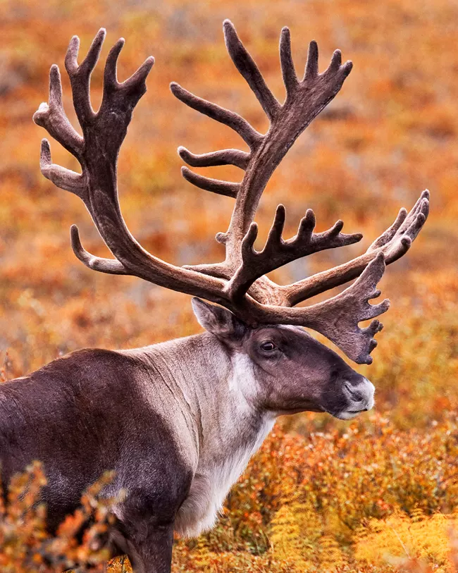
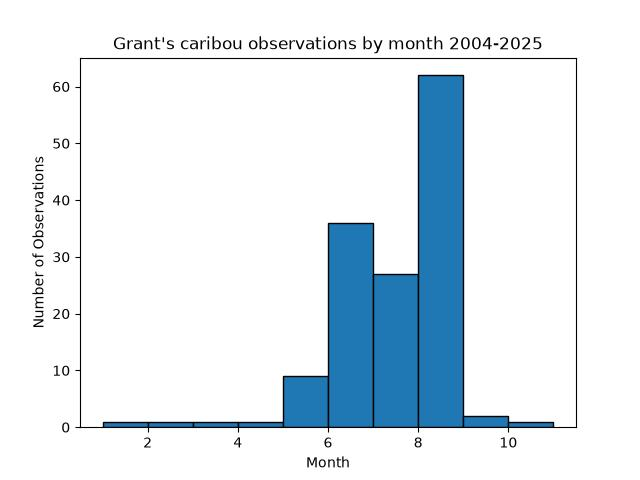
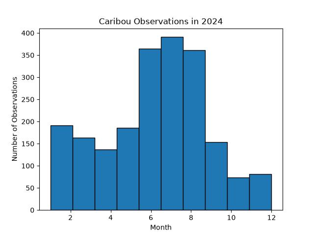

# Caribou Migration

**Figure 1:** *Source: NPS, K. Conger, (https://www.nps.gov/articles/000/reinderrvscaribou.htm)*

Caribou have the longest migration of any land mammal on the planet, often covering over 2,000 miles every year (Grosvenor). Their migration is mainly motivated by their reproduction patterns and the need to avoid predators during their calving seasons, typically in late May and early June (National Park Service). Caribou descended from Eurasia, and arrived to North America via the Bering Land Bridge hundreds of thousands of years ago (Joly). 

This project investigates the migratory patterns of the species, *Rangifer tarandus* along with a subspecies of caribou, the *Rangifer tarandus granti*, also known as the Western Arctic Caribou. This subspecies is one of the largest herds that resides in North America.  

Both of these datasets had their own limits, which highlights the challenges that can come with mapping migratory species. Filtering down to just the Western Arctic Caribou limits the number of observations. This is why all of the 21st century data on this subspecies was kept, rather than filtering down to just one year. 

    
    

**Figure 2:** *There are much fewer Western Arctic Caribou observations from 2004-2025 than there are for just one single year of the entire caribou species in 2024.*

Another limit of mapping caribou migration patterns is that most of the observations are from summer months, since they reside in colder climates. This means that the map during winter months may not be as informational as it is for summer months.

<embed type="text/html" src="./img/caribou_migration.html" width="1200" height="800">

**Figure 3:** *Western Arctic Caribou migration by month from 2004-2025.*

This map clearly shows the difference in the number of observations that are taken during summer and winter months more than it shows the migration patterns of Wester Arctic Caribou. It also shows how using ecoregions can be misleading since once there are observations in the tundra biome, it appears that there are observations of caribou in Antarctica which is not accurate. 

<embed type="text/html" src="./img/global_caribou_migration.html" width="1200" height="800">

**Figure 4:** *Caribou migration in 2024 by month.*

Because this shows the entire caribou species and many observations of many different herds, it is difficult to observe their seasonal patterns via this map. This map does illustrate how there are many more observations during summer months and that those observations appear to occur more north than in the winter months, which is confirmed by literature on their migratory habits. 

## Conclusions

This project highlights the challenges that can come with mapping migratory species, especially those that are mainly tracked by human observation rather than tracking devices. Because caribou are herd animals, it is challenging to effectively plot their migration with the data that is available. Further investigation could include zooming into one specific herd or a smaller region to better visualize these migration patterns. 

The notebooks used to produce this analysis can be accessed at the following links:
1. [*Rangifer tarandus granti*](https://github.com/sofieappel/sofieappel.github.io/blob/main/migration_project.ipynb)
2. [*Rangifer tarandus*](https://github.com/sofieappel/sofieappel.github.io/blob/main/migration_project_pt2.ipynb)

## References

Caribou vs. Reindeer. *National Park Service*. (https://www.nps.gov/articles/000/reinderrvscaribou.htm)

Grosvenor, Madison. (2025). On beings and biomes--caribou and their migrations. *Trustees for Alaska*. (https://trustees.org/on-beings-and-biomes-caribou-and-their-migrations/)

Joly, K., Rasic, J., Mason, R., & Lukin, M. History, Purpose, and Status of Caribou Movements in Northwest Alaska. *National Park Service*. (https://www.nps.gov/articles/aps-17-1-7.htm)

